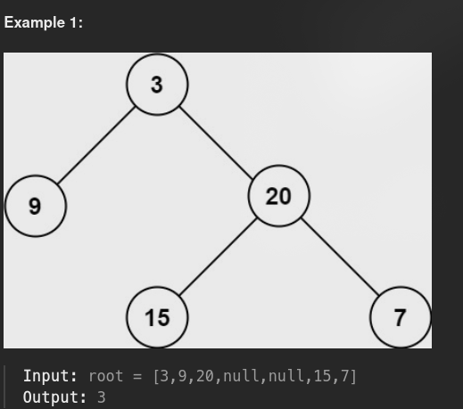

## problem

Given the root of a binary tree, return its maximum depth.

A binary tree's maximum depth is the number of nodes along the longest path from the root node down to the farthest leaf node.

 

## examples

```
Input:
Output:
```



Example 2:

Input: root = [1,null,2]
Output: 2

 

# constraints:

    The number of nodes in the tree is in the range [0, 104].
    -100 <= Node.val <= 100
